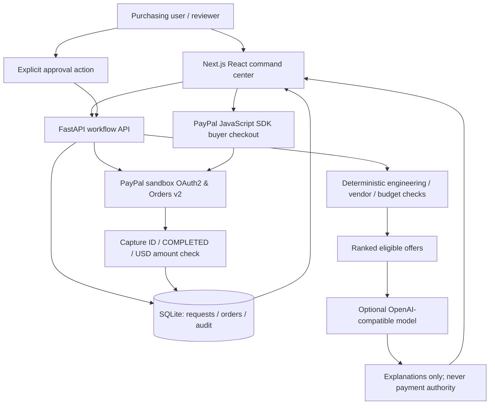

# System architecture

## State machine

`NEW -> ANALYZED -> APPROVED -> ORDER_CREATED -> PAID`

The LLM only explains deterministic eligible results; if it fails, the app labels `rules-only` and never claims real AI inference. Purchasing approval is a local demo button, not identity-enforced authorization. The PayPal buyer separately approves checkout with a sandbox buyer account. A recorded successful capture requires a matching server-side request, PayPal order ID, exact amount, currency and COMPLETED capture status.

## API controls

- PayPal secret never enters frontend; only public client ID does.
- Orders can only be created after selecting an eligible offer via approval action.
- Server recalculates amounts from its fixture catalog; client cannot submit payment amount.
- `orders.request_id` has a unique constraint; existing completed captures are returned idempotently.
- PayPal-Request-Id is stable for create and capture retries.
- Capture failures never mark a request `PAID`.
- The sandbox host is hard-coded server-side.

## Unimplemented production protections

Authn/authz, signing PayPal webhooks, reconciliation state machine, database concurrency locks, production-quality spend approvals, catalog integrations, tax and delivery handling. Do not use or expose as a real purchasing service.
